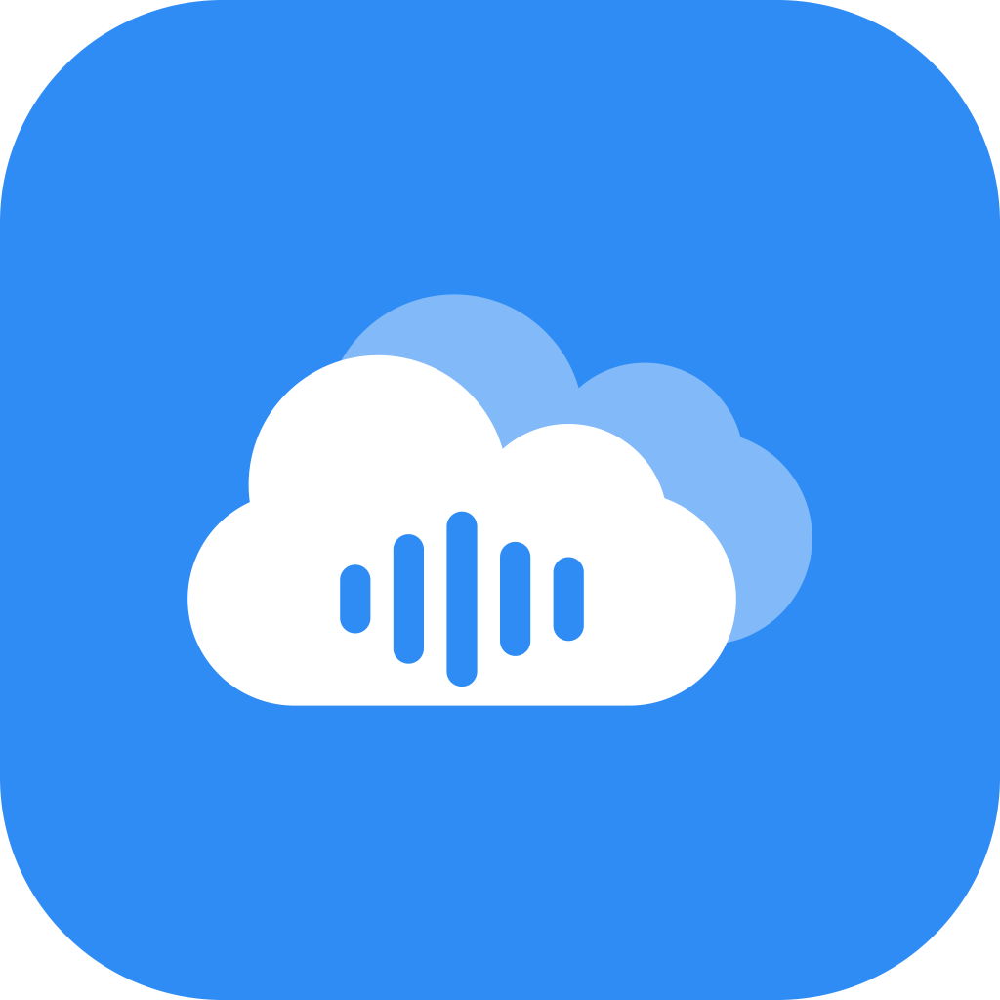
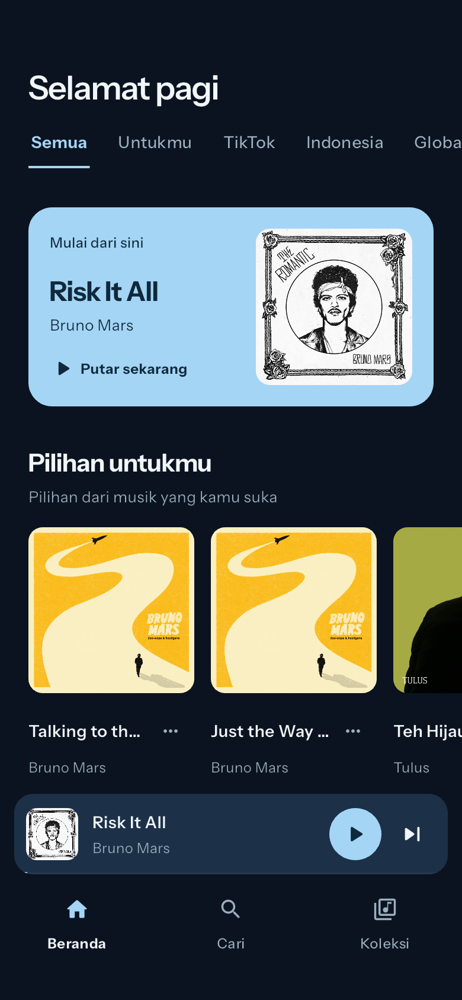
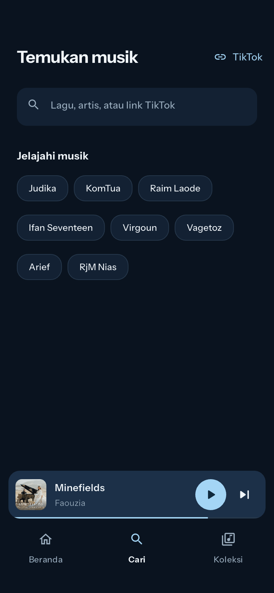
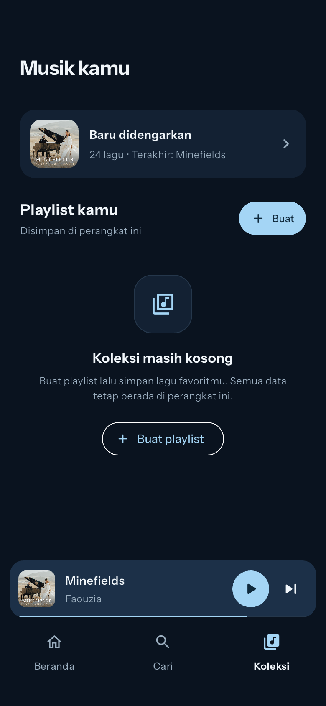
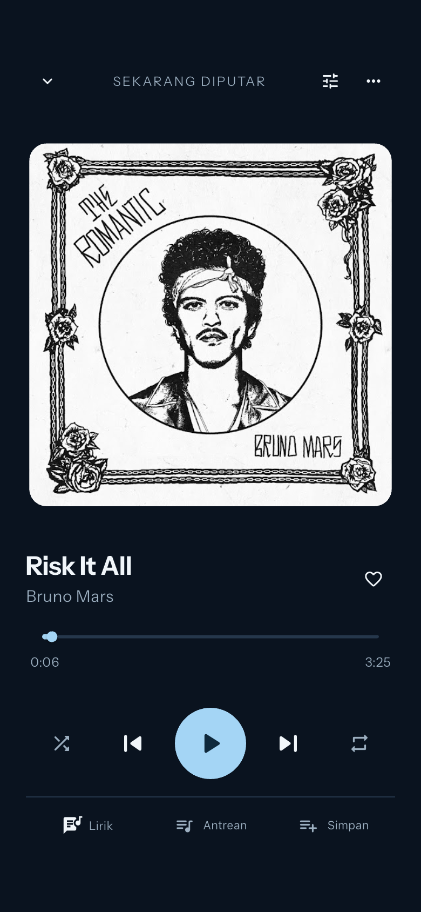
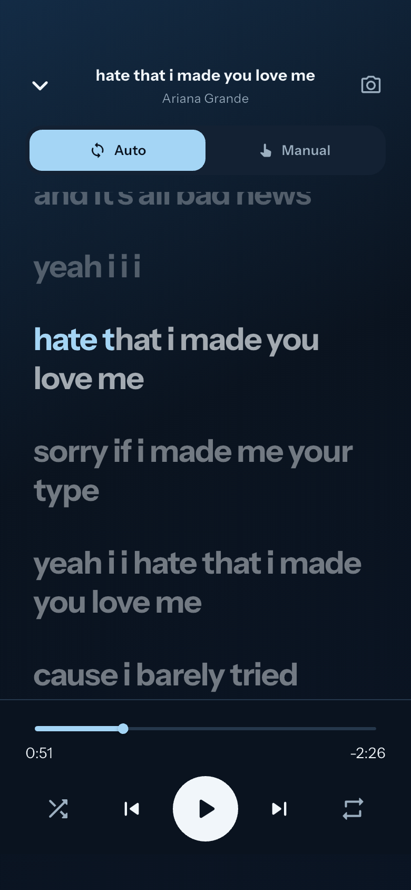

<div align="center">
  
  <h1>Cloudio</h1>
  <p><strong>Aplikasi Pemutar Musik, Pengenal Audio & Lirik Real-Time untuk Android dan iOS</strong></p>
  <p>Temukan lagu favorit, kenali lagu di sekitarmu, putar sound asli TikTok, karaoke, dan dengarkan offline tanpa kuota.</p>
  <p>
    <a href="#-unduh-aplikasi">Unduh Rilis</a> ·
    <a href="#-tangkapan-layar">Tangkapan Layar</a> ·
    <a href="#-panduan-instalasi-ios-via-sideloadly">Panduan iOS</a> ·
    <a href="#-sumber-data">Sumber Data</a> ·
    <a href="#-build-dari-source-code">Build Sendiri</a>
  </p>
  <p>
    
    
    <a href="LICENSE"></a>
  </p>
</div>

---

## 📸 Tangkapan Layar

<div align="center">
  <table>
    <tr>
      <td align="center" width="20%">
        <strong>Beranda</strong><br><br>
        
      </td>
      <td align="center" width="20%">
        <strong>Pencarian</strong><br><br>
        
      </td>
      <td align="center" width="20%">
        <strong>Koleksi & Offline</strong><br><br>
        
      </td>
      <td align="center" width="20%">
        <strong>Pemutar Musik</strong><br><br>
        
      </td>
      <td align="center" width="20%">
        <strong>Lirik Real-Time</strong><br><br>
        
      </td>
    </tr>
  </table>
</div>

---

## ✨ Fitur Utama

- **Penemuan & Katalog Musik:** Jelajahi jutaan lagu, artis, album, dan playlist terpopuler tanpa iklan audio yang mengganggu.
- **Kenali Lagu (Audio Recognition):** Dengarkan cuplikan audio di sekitarmu lewat mikrofon, dan Cloudio akan langsung mengenali judul lagu serta artisnya.
- **Sound Asli TikTok:** Tempel link video TikTok untuk memutar audio asli kreasi kreator (termasuk versi *slowed*, *reverb*, maupun *sped-up*).
- **Lagu Offline Sepenuhnya:** Unduh lagu, lirik, dan cover album langsung ke memori internal HP (kuota hingga 5 GB). Putar kapan saja saat data seluler mati atau di Mode Pesawat.
- **Lirik Real-Time & Karaoke:** Dukungan lirik sinkron kata-demi-kata dengan opsi mode Karaoke (vokal dikurangi secara cerdas).
- **Background & Lockscreen Audio:** Tetap memutar musik saat layar HP terkunci atau saat membuka aplikasi lain, lengkap dengan kontrol media sistem iOS dan Android.
- **Tampilan Pemutar Kustom:** Pilihan visualizer audio, piringan hitam (vinyl), kaset retro, hingga lirik mengalir.

---

## 📥 Unduh Aplikasi

Paket rilis terbaru siap unduh langsung dari halaman [GitHub Releases](https://github.com/asepirfans/cloudio-mobile/releases/latest):

| Platform | Format File | Ukuran | Keterangan & Link Unduh |
|---|---|---|---|
| **Android (Modern)** | `.apk` (ARM 64-bit) | **~21 MB** | **Direkomendasikan.** Untuk 99% HP Android modern (Samsung, Xiaomi, Oppo, Vivo, Poco, Realme, Pixel, Infinix).<br>👉 **[Unduh app-arm64-v8a-release.apk](https://github.com/asepirfans/cloudio-mobile/releases/latest/download/app-arm64-v8a-release.apk)** |
| **Android (Universal)** | `.apk` (All-in-one) | ~57 MB | Berisi seluruh arsitektur prosesor jika versi ARM64 tidak kompatibel.<br>👉 **[Unduh app-release.apk](https://github.com/asepirfans/cloudio-mobile/releases/latest/download/app-release.apk)** |
| **iPhone / iPad** | `.ipa` | ~30 MB | Paket instalasi untuk iOS menggunakan Sideloadly atau AltStore.<br>👉 **[Unduh Runner.ipa](https://github.com/asepirfans/cloudio-mobile/releases/latest/download/Runner.ipa)** |

---

## 📲 Panduan Instalasi iOS (iPhone / iPad) via Sideloadly

Karena Cloudio adalah proyek open-source independen yang tidak didistribusikan lewat Apple App Store resmi, pengguna iPhone dapat menginstalnya secara gratis menggunakan metode **Sideloading**.

### Alat yang Dibutuhkan:
1. Laptop / Komputer (Windows atau macOS).
2. Kabel data USB untuk menghubungkan iPhone ke komputer.
3. Aplikasi **Sideloadly** (Unduh gratis dari situs resmi: [sideloadly.io](https://sideloadly.io/)).
4. Akun Apple ID pribadi (akun gratis biasa, tidak butuh akun berbayar).

### Langkah-langkah Instalasi:
1. **Unduh File IPA:** Unduh file `Runner.ipa` dari [GitHub Releases](https://github.com/asepirfans/cloudio-mobile/releases/latest).
2. **Pasang Sideloadly:** Pasang dan buka Sideloadly di komputermu (pastikan iTunes / iCloud versi desktop sudah terpasang jika menggunakan Windows).
3. **Hubungkan iPhone:** Colokkan iPhone ke komputer dengan kabel data. Jika muncul dialog *"Percayai Komputer Ini?"*, pilih **Percayai (Trust)** dan masukkan passcode layar kuncimu.
4. **Drag & Drop File IPA:** Seret file `Runner.ipa` yang sudah diunduh ke dalam jendela Sideloadly.
5. **Masukkan Apple ID:** Masukkan alamat email Apple ID kamu pada kolom *Apple ID*.
6. **Mulai Pemasangan:** Klik tombol **Start**. Masukkan password Apple ID dan kode autentikasi 2 faktor jika diminta. Tunggu proses hingga status menunjukkan `Done`.
7. **Beri Izin di iPhone (Trust Certificate):**
   - Di iPhone, buka **Pengaturan (Settings) $\rightarrow$ Umum (General) $\rightarrow$ VPN & Manajemen Perangkat (VPN & Device Management)**.
   - Ketuk email Apple ID kamu pada daftar *Aplikasi Pengembang (Developer App)*.
   - Pilih **Percayai (Trust) "[Email Kamu]"**, lalu konfirmasi.
8. Buka ikon Cloudio di layar utama iPhone kamu dan nikmati musiknya!

### ⚠️ Batasan Sideloading (Kebijakan Akun Apple Gratis):
- **Masa Berlaku 7 Hari:** Apple membatasi sertifikat developer gratis hingga **7 hari**. Setelah 7 hari, aplikasi akan ditutup sendiri dan perlu di-*re-sign* (cukup colokkan kembali ke komputer dan klik Start di Sideloadly, semua data lagu offline kamu tetap aman).
  > **Tips Sideloadly:** Kamu bisa menyalakan opsi **"Wi-Fi Sideloading"** di setelan Sideloadly agar komputer dan iPhone otomatis memperbarui masa aktif aplikasi lewat jaringan Wi-Fi rumah tanpa perlu colok kabel berulang kali.
- **Batas Maksimal Aplikasi:** Apple membatasi maksimal **3 aplikasi sideload aktif** secara bersamaan per perangkat untuk akun Apple gratis.

---

## 🌐 Sumber Data

Cloudio menggunakan berbagai sumber data publik dan pustaka open-source berikut:

### 1. Sumber Lirik Musik
* **Utama: [LRCLIB](https://lrclib.net/)**
  - Penyedia lirik musik open-source berbasis komunitas yang menyediakan lirik teks biasa dan lirik sinkron kata-demi-kata (LRC).
  - Dokumentasi API resmi: [lrclib.net/docs](https://lrclib.net/docs).
* **Cadangan: [Kugou Music](http://kugou.com/) & YouTube Music Panel**
  - Digunakan sebagai penelusuran alternatif saat lirik belum tersedia di basis data utama.

### 2. Katalog & Audio Streaming
* **Katalog & Metadata:**
  - Ditampilkan melalui pustaka open-source [`youtube_explode_dart`](https://pub.dev/packages/youtube_explode_dart) (Lisensi MIT).
* **Streaming Media:**
  - Pemutaran dilakukan langsung secara lokal di sisi perangkat (*client-side on-device extraction*).
  - Dilengkapi arsitektur pemulihan pemutaran (*smart failover recovery*) otomatis untuk menjamin ketersediaan pemutaran musik saat jaringan lokal menghadapi pembatasan cipher.

### 3. Sound TikTok
* Didukung oleh parser metadata publik `TikTokSoundService`. Cloudio mengizinkan pemutaran audio asli dari video publik yang dibagikan secara terbuka oleh kreator.

### 4. Pengenalan Lagu (Audio Recognition)
* Menggunakan port algoritma sidik jari akustik murni Dart dari [`shazam_identifier`](https://pub.dev/packages/shazam_identifier) (Lisensi MIT).
* *Privasi:* Rekaman suara mikrofon diproses menjadi hash sidik jari frekuensi secara lokal di perangkat. **File rekaman suara asli mikrofon tidak pernah disimpan atau diunggah ke server.**

### 5. Tipografi & Ikon
* **Font:** [Instrument Sans](https://github.com/Instrument/instrument-sans) di bawah lisensi [SIL Open Font License 1.1](assets/fonts/OFL.txt).
* **Ikon:** Material Icons bawaan Flutter & Cupertino Icons.

---

## 🛠️ Build dari Source Code

### Prasyarat:
- Flutter SDK `^3.24.5` / Dart SDK `^3.5.4`
- Android Studio / Android SDK (untuk build Android)
- macOS dengan Xcode dan CocoaPods (untuk build iOS)

### 1. Kloning & Persiapan:
```bash
git clone https://github.com/asepirfans/cloudio-mobile.git
cd cloudio-mobile
flutter pub get
```

### 2. Kompilasi APK Android:
```bash
# Build APK ringan per arsitektur (direkomendasikan)
flutter build apk --split-per-abi --release

# Hasil build akan berada di:
# build/app/outputs/flutter-apk/app-arm64-v8a-release.apk
```

### 3. Kompilasi IPA iOS:
```bash
cd ios && pod install && cd ..
flutter build ipa --release
```

---

## 📄 Lisensi

Kode sumber Cloudio Mobile dilisensikan di bawah [Lisensi MIT](LICENSE).  
Hak cipta lagu, lirik, sampul album, dan merek dagang pihak ketiga tetap merupakan hak milik eksklusif dari masing-masing pemilik hak cipta dan penyedia layanan terkait.
